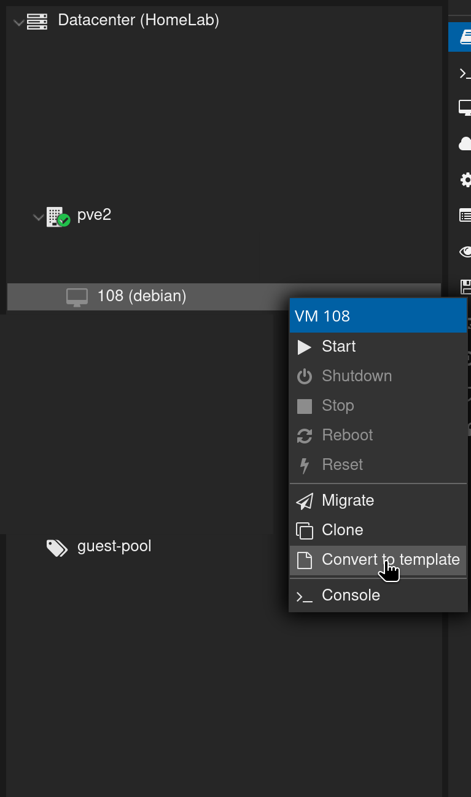
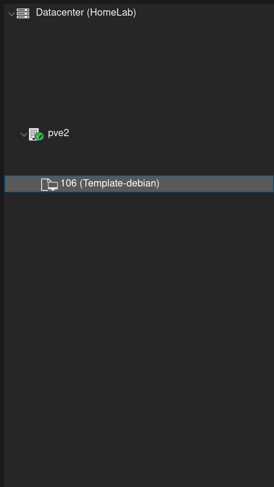
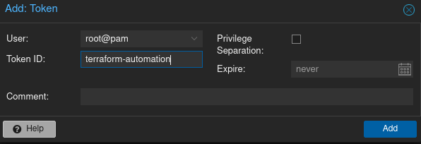
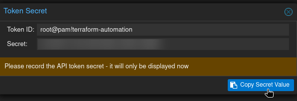

# HomeLab Infra as Code — Terraform

> **Avant tout :** copie le fichier de variables d'exemple et remplis-le avec tes valeurs.
>
> ```bash
> cp terraform/proxmox-vms/terraform.tfvars.example terraform/proxmox-vms/terraform.tfvars
> ```
>
> Sans `terraform.tfvars`, Terraform te demande chaque variable à la main. Le fichier est ignoré par git : ton token n'est jamais versionné.

Automatisation de la création des VM sur mon cluster Proxmox via Terraform, plutôt que de les créer manuellement dans l'interface web à chaque fois.

## Contexte

Jusqu'ici, chaque VM (monitoring, sites web, futurs projets) était créée à la main dans Proxmox. L'objectif de ce projet est de décrire l'infrastructure en code : une VM devient une simple description dans un fichier, reproductible et versionnable.

## Où ça tourne

Terraform n'est pas un service qui tourne en permanence — c'est un outil en ligne de commande, exécuté ponctuellement depuis mon **PC Admin (Debian)**. Il communique avec l'**API Proxmox** pour créer/modifier/détruire des VM selon ce qui est décrit dans les fichiers.

```
PC Admin (Debian) → terraform apply → API Proxmox (port 8006) → création/modification des VM
```

## Stack utilisée

- **Terraform** — décrit l'infrastructure voulue, compare avec l'état actuel, applique les changements nécessaires
- **Provider `Telmate/proxmox`** — permet à Terraform de piloter Proxmox VE

## Arborescence du projet

```plaintext
~/terraform/
├── proxmox-vms/
│   ├── main.tf              # définition des VM
│   ├── variables.tf         # déclaration des variables
│   ├── terraform.tfvars         # valeurs réelles (jamais versionné)
│   ├── terraform.tfvars.example # modèle à copier
│   └── providers.tf         # configuration du provider Proxmox
└── Autre-Projet/            # dossier dédié à un autre projet
```

Un dossier par projet, pour garder chaque infra isolée et lisible séparément.

## Authentification à l'API Proxmox

Utilisation d'un utilisateur Proxmox dédié et d'un token API dédié à Terraform.

> **Sécurité** — `terraform.tfvars` contient le token API Proxmox. Fichier exclu du dépôt via `.gitignore`, avec un `terraform.tfvars.example` fourni à la place, contenant uniquement des placeholders.

Exemple :

```terraform
pm_api_token_secret = "TON_SECRET_ICI"
```

## Fichiers à ne jamais versionner

```
terraform.tfvars
.terraform/
*.tfstate
*.tfstate.backup
```

Le fichier `.tfstate` contient l'état actuel de l'infrastructure gérée par Terraform (parfois avec des données sensibles en clair) — à traiter avec la même prudence qu'un secret.

## Utilisation — lancer Terraform de A à Z

### Prérequis

- Terraform installé sur le PC Admin (`terraform version` doit répondre).
- Un token API Proxmox (voir étapes 3 et 4 plus bas).
- Un template Proxmox prêt à être cloné, avec cloud-init (étape 1).
- Une clé SSH publique en `~/.ssh/id_ed25519.pub` : `main.tf` l'injecte dans la VM. Absente, génère-la avec `ssh-keygen -t ed25519`.

### Commandes

```bash
# 1. Aller dans le dossier du projet
cd terraform/proxmox-vms

# 2. Créer le fichier de variables, puis le remplir (voir « Avant tout »)
cp terraform.tfvars.example terraform.tfvars
nano terraform.tfvars

# 3. Télécharger le provider Proxmox
terraform init

# 4. Vérifier la syntaxe
terraform validate

# 5. Voir ce qui va être créé, sans rien appliquer
terraform plan

# 6. Créer la VM (taper « yes » pour confirmer)
terraform apply
```

### Vérification

La VM apparaît dans l'interface Proxmox, puis répond en SSH avec les valeurs `ci_user` et `ip` de ton `terraform.tfvars` :

```bash
ssh <ci_user>@<ip>
```

### Modifier ou supprimer la VM

Change une valeur dans `terraform.tfvars` ou `main.tf`, puis relance `terraform plan` et `terraform apply`. Pour supprimer la VM :

```bash
terraform destroy
```

## Étapes réalisées

### 1. Préparation du template Debian

Le template `Template-debian` (VM 108, sur le nœud `pve2`) a été préparé au préalable — Debian minimale, `qemu-guest-agent`, `sudo` configuré, node_exporter installé — puis converti en template Proxmox.



### 2. Conversion en template

Une fois la VM 106 prête et éteinte proprement, elle a été convertie en template via **clic droit → Convert to template**, la rendant clonable par Terraform.



### 3. Création du token API dédié à Terraform

Dans **Datacenter → Permissions → API Tokens**, création d'un token pour l'utilisateur `root@pam`, avec l'ID `terraform-automation`. La case **Privilege Separation** a été laissée décochée pour ce premier test, ce qui donne au token les mêmes droits que `root@pam`.



> À terme, il serait plus propre de créer un utilisateur dédié (ex: `terraform@pam`) avec un rôle restreint aux droits nécessaires à la création/modification de VM, plutôt que d'hériter des droits complets de `root`.

### 4. Récupération du secret du token

Le secret n'est affiché **qu'une seule fois** à la création — il a été copié immédiatement dans `terraform.tfvars` (jamais versionné, voir plus haut).



## Premier test — clone du template

Avec `main.tf` pointant vers `target_node = "pve2"` et `clone = "Template-debian"`, le cycle `terraform init` → `terraform plan` → `terraform apply` a permis de cloner le template en une nouvelle VM automatiquement, sans passer par l'interface Proxmox.

## Statut du projet

Première VM clonée avec succès via Terraform, connexion à l'API Proxmox validée. Prochaine étape : étendre la configuration à la gestion d'autres projets (variables réutilisables, plusieurs VM décrites dans un seul plan).